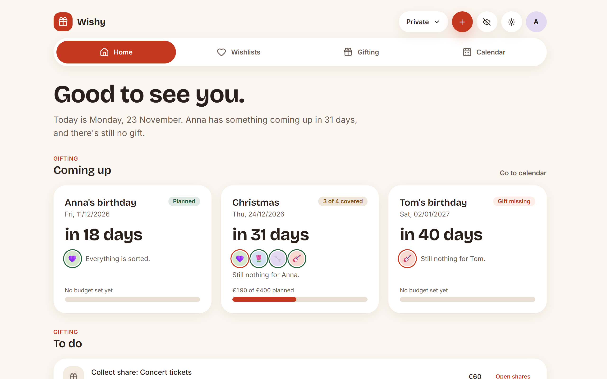
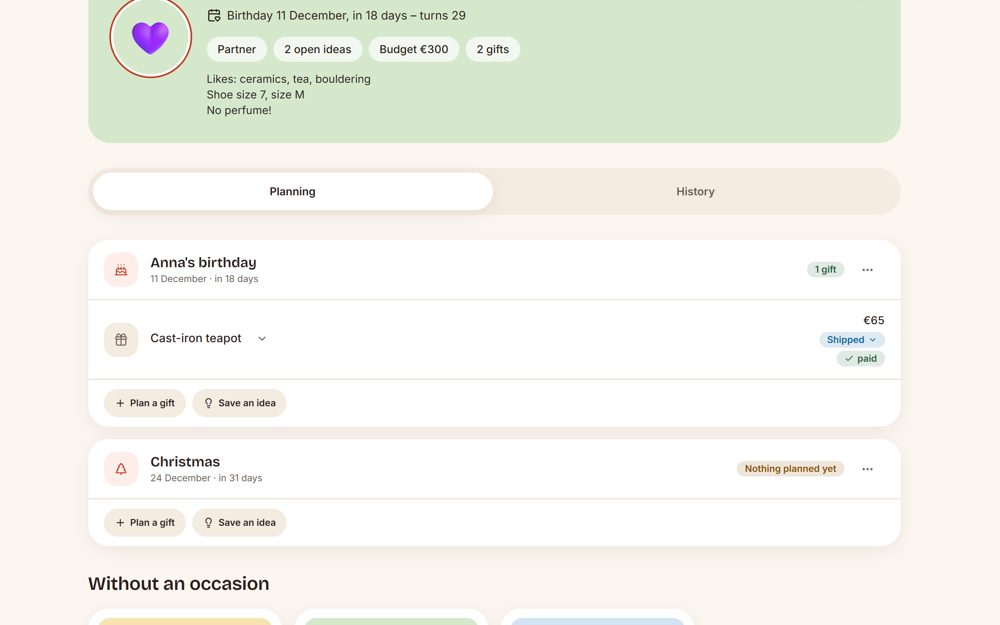
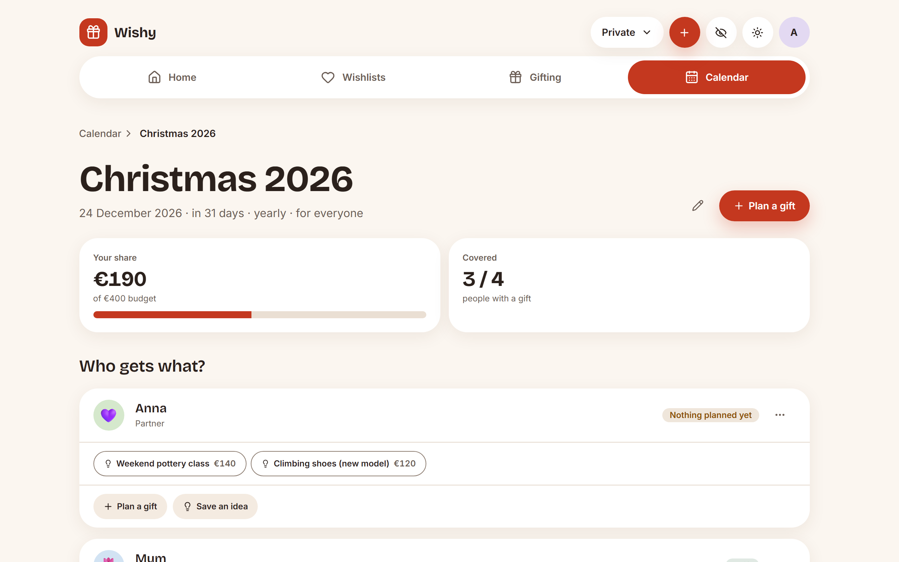
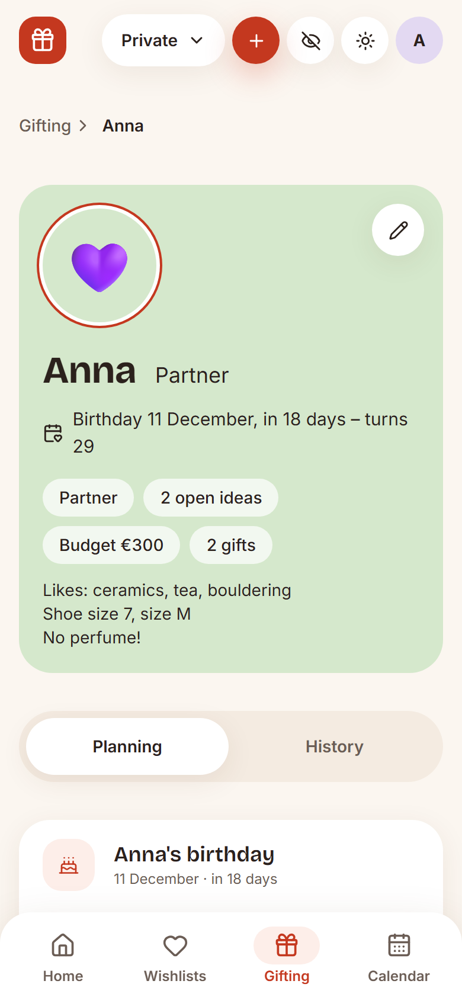

<div align="center">


# Wishy

**Wish lists, gift ideas and shared gift planning – self-hosted.**

[](https://github.com/veniplex/wishy/actions/workflows/ci.yml)
[](https://github.com/veniplex/wishy/releases)
[](https://github.com/veniplex/wishy/pkgs/container/wishy)

[Quick start](#quick-start) · [Features](#features) · [Configuration](#configuration) · [Operations guide](docs/operations.md) · [Changelog](CHANGELOG.md)

<picture>
  <source media="(prefers-color-scheme: dark)" srcset="docs/screenshots/dashboard-dark.png">
  
</picture>

</div>

Plan gifts around the people you give them to: collect ideas, keep track of birthdays and occasions, share the cost and
stay within budget. Share your own wish lists with anyone, and never see what has been reserved for you. Everything runs
in one container with one SQLite file. The interface is available in English and German.

## Features

- 🎁 **Wish lists:** as many as you like, shared by link (no account needed) or with other users. Guests reserve items and
  the owner never finds out which.
- 🧑‍🤝‍🧑 **Person-centred planning:** each person has a birthday, ideas and gifts, grouped by occasion. Occasions apply to
  everyone or to selected people, and you can leave individuals out.
- 📅 **Calendar:** month grid and list, recurring occasions and birthdays, your own occasion types.
- 🏠 **Spaces:** plan together with invite links and permissions per member.
- 💶 **Budgets and cost sharing:** gift status, payments, who owes what, spending overview.
- 🔗 **Link import:** title, image and price from product pages, with headless Chromium when needed.
- 📱 **Works offline:** install it as an app (PWA, needs HTTPS). Your data is available without a connection; changes are
  kept on the device and synchronised as soon as the server is reachable again.
- 🔐 **Accounts:** email and password, 2FA (TOTP), passkeys, Google sign-in; open, invite-only or closed registration.
- 🛠️ **Administration:** users, audit log, REST API with API keys, optional AI features (Anthropic, OpenAI, Google).
- 🔄 **Operations:** encrypted backups, signed updates of the app or the whole image, automatic rollback.

## Screenshots

| Planning for a person | Planning an occasion |
| --- | --- |
|  |  |
| **Calendar** | **Wish list** |
|  |  |

<div align="center"></div>

## Quick start

You need Docker with the Compose plugin.

**1.** Create a folder with a `data` directory. The container runs as UID 1000:

```bash
mkdir wishy && cd wishy
mkdir -p data && sudo chown 1000:1000 data
```

**2.** Save this as `docker-compose.yml` (the same as [the file in the repository](docker-compose.yml)). It works as it is;
every available setting is listed as a comment:

```yaml
# Wishy. All settings are optional: remove the "# " in front of a variable to set it. The value shown is the default or an example.
# Google, AI, base URL, proxy and backup passphrase can also be set in the app (Admin); a variable set here wins.
services:
  wishy:
    image: ${WISHY_IMAGE:-ghcr.io/veniplex/wishy:latest}
    # build: .                                      # build from a checkout of the repository instead
    container_name: wishy
    restart: unless-stopped
    stop_grace_period: 30s
    ports:
      - "3000:3000"                                 # host:container
    volumes:
      - ./data:/data                                # database, images, keys, backups (must belong to UID 1000)
      # Docker API, only for updating the WHOLE image from within the app, option A (see the end of this file):
      # - /var/run/docker.sock:/var/run/docker.sock
    # group_add: ["999"]                            # option A: GID of the socket on the host (stat -c %g /var/run/docker.sock)
    cap_drop: [ALL]
    security_opt: [no-new-privileges:true]
    # read_only: true                               # stricter, then also:
    # tmpfs: [/tmp]

    environment:
      # --- General -----------------------------------------------------------------------------------------
      TZ: Europe/Berlin                             # time zone (backup schedule, "today"); without it: UTC
      # BASE_URL: https://wishy.example.com         # public address for links, invitations and Google sign-in; default: from the request
      # TRUST_PROXY: "1"                            # behind a reverse proxy: number of proxies in front of the container, "true" or subnets
      # ALLOWED_ORIGINS: https://wishy.example.com  # further addresses the app is opened under (comma separated)
      # PORT: "3000"                                # port inside the container (then change "ports" as well)
      # HOST: 0.0.0.0                               # bind address inside the container
      # APP_PORT: "3001"                            # internal port between launcher and app; default: PORT + 1
      # DATA_DIR: /data                             # data folder inside the container (then change "volumes" as well)

      # --- Google sign-in ----------------------------------------------------------------------------------
      # GOOGLE_CLIENT_ID: ""                        # both are needed; redirect URI: <BASE_URL>/api/auth/google/callback
      # GOOGLE_CLIENT_SECRET: ""

      # --- AI features (switched on in Admin) --------------------------------------------------------------
      # AI_PROVIDER: anthropic                      # anthropic | openai | google | openai_compatible
      # AI_API_KEY: ""
      # AI_MODEL: ""                                # empty: default model (Anthropic only), otherwise required
      # AI_BASE_URL: http://ollama:11434/v1         # only for openai_compatible (Ollama, LM Studio, Mistral ...)

      # --- Link import -------------------------------------------------------------------------------------
      # PREVIEW_BROWSER: "off"                      # never start headless Chromium (plain fetch only)
      # PREVIEW_BROWSER_NO_SANDBOX: "1"             # already set in the image (a container has no user namespaces)
      # CHROME_PATH: /usr/bin/chromium              # already set in the image

      # --- Backups -----------------------------------------------------------------------------------------
      # BACKUP_PASSPHRASE: ""                       # overrides the one in Admin; encrypted backups cannot be restored without it

      # --- Updates -----------------------------------------------------------------------------------------
      # UPDATE_REPO: veniplex/wishy                 # source of updates (forks)
      # UPDATE_TOKEN: ""                            # GitHub token, only against the rate limit or for a private fork
      # UPDATE_PUBLIC_KEY: ""                       # Base64 public key, only for forks that sign their own releases
      # UPDATE_API_BASE: https://api.github.com     # other GitHub API (GitHub Enterprise)
      # UPDATE_ALLOWED_HOSTS: ""                    # further download hosts (comma separated)
      # WISHY_IMAGE_UPDATES: "off"                  # never update the image, even if the Docker API is reachable
      # DOCKER_HOST: tcp://docker-proxy:2375        # option B, or unix:///path; default: /var/run/docker.sock if mounted
      # DOCKER_REGISTRY_AUTH: ""                    # X-Registry-Auth header for a private registry
      # WISHY_CONTAINER_ID: wishy                   # own container, only if it is not detected automatically
      # WISHY_HEALTH_TIMEOUT_MS: "90000"            # a new version must be healthy within this time
      # WISHY_SWAP_TIMEOUT_MS: "150000"             # image update: limit for replacing the container; default: health timeout + 60 s
      # WISHY_PROVEN_MS: "600000"                   # a new version counts as stable after this time
      # WISHY_MAX_ARTIFACT_MB: "512"                # largest accepted app update

      # --- Special cases -----------------------------------------------------------------------------------
      # WISHY_MAX_CONNECTIONS: "2000"               # limit of open connections
      # WISHY_ALLOW_NEW_SECRET_KEY: "1"             # ONE start after losing secret.key: makes a new one, 2FA and stored secrets are lost

# ---- Updates and the Docker API ---------------------------------------------------------------------------
# Not needed for app updates: they work out of the box and replace the app and its npm packages.
# Only an update of the whole image (Node, Alpine, Chromium, launcher) from within the app needs the Docker API. Without it:
# "docker compose pull && docker compose up -d". Access to the Docker API is roughly root on the host, so it is off by default.
#   Option A (simple, full access): remove the "# " before the docker.sock volume and "group_add" above.
#   Option B (recommended, only the needed calls): socket proxy on an internal network. Remove the "# " before DOCKER_HOST above and
#   the "#" from the lines below, and add to the wishy service:
#     networks: [default, docker-api]
#     depends_on: [docker-proxy]
#
#  docker-proxy:
#    image: wollomatic/socket-proxy:1.10.0
#    restart: unless-stopped
#    read_only: true
#    cap_drop: [ALL]
#    security_opt: [no-new-privileges:true]
#    user: "65534:999"                              # 999 = GID of the socket on the host
#    volumes:
#      - /var/run/docker.sock:/var/run/docker.sock:ro
#    networks: [docker-api]
#    command:
#      - -loglevel=info
#      - -listenip=0.0.0.0
#      - -allowGET=^/(v1\.4[1-5]/)?version$|^/v1\.4[1-5]/(containers/[a-zA-Z0-9_.-]+/json|images/[a-zA-Z0-9_.:/@-]+/json)$
#      - -allowPOST=^/v1\.4[1-5]/(containers/create|containers/[a-zA-Z0-9_.-]+/(start|stop|rename)|images/create|networks/[a-zA-Z0-9_.-]+/connect)
#      - -allowDELETE=^/v1\.4[1-5]/(containers/[a-zA-Z0-9_.-]+|images/[a-zA-Z0-9_.:@-]+)
#      - -allowHEAD=^/_ping$
#
#networks:
#  docker-api:
#    internal: true                                 # no internet, only Wishy <-> proxy
```

**3.** Start it and open <http://localhost:3000> to create the administrator account:

```bash
docker compose up -d
```

Your data lives in `./data`; back it up, including `secret.key`.

<details>
<summary><b>Pin a version</b></summary>

Replace `latest` with a version, for example `ghcr.io/veniplex/wishy:1.0.0`. With a fixed tag you have to raise the tag
yourself after an in-app image update; with `latest`, `docker compose up -d` stays up to date.

</details>

<details>
<summary><b>Update</b></summary>

*Admin › Updates* shows and installs new versions (signed, with a backup and rollback). Or manually:

```bash
docker compose pull && docker compose up -d
```

These updates replace the app and its npm packages and need no access to Docker. Updating the whole image (Node, Alpine,
Chromium) from within the app needs the Docker API: mount `docker.sock` (option A) or use the socket proxy (option B), both
prepared in the Compose file. This access is roughly root on the host, so it is off by default; please read
[the notes](docs/operations.md#32-image-updates-whole-container) first.

</details>

<details>
<summary><b>Reverse proxy and HTTPS</b></summary>

On the internet, only run Wishy behind HTTPS (session cookies, passkeys, Google sign-in). Set `BASE_URL` and
`TRUST_PROXY` (number of proxy hops in front of the container). Details: [docs/operations.md](docs/operations.md#2-docker).

</details>

<details>
<summary><b>Google sign-in (optional)</b></summary>

In the Google Cloud Console, create an OAuth client ID (type "Web application"), add `<BASE_URL>/api/auth/google/callback`
as the redirect URI, and set the client ID and secret in *Admin › Sign-in* (or via
`GOOGLE_CLIENT_ID` / `GOOGLE_CLIENT_SECRET`).

</details>

## Configuration

All environment variables are listed with their defaults in the [Compose file](#quick-start). The ones you are most likely
to need:

| Variable | Default | Meaning |
| --- | --- | --- |
| `BASE_URL` | from the request | Public address (links, Google redirect), e.g. `https://wishy.example.com` |
| `TRUST_PROXY` | – | Behind a reverse proxy: number of hops, `true` or subnets |
| `TZ` | UTC | Time zone (backup schedule, "today") |
| `GOOGLE_CLIENT_ID` / `GOOGLE_CLIENT_SECRET` | – | Google sign-in |
| `AI_PROVIDER` / `AI_API_KEY` / `AI_MODEL` / `AI_BASE_URL` | – | AI features |
| `BACKUP_PASSPHRASE` | – | Overrides the passphrase set in *Admin › Backups* |
| `DOCKER_HOST` | – | Docker API for image updates (see the security notes) |

Without Docker (`npm start`), `HOST` defaults to `127.0.0.1` and `DATA_DIR` to `./data`. More about updates, proxies and
backups: [docs/operations.md](docs/operations.md).

## Security notes

- **Back up `secret.key` (in `DATA_DIR`).** It seals 2FA secrets, passphrases and tokens. Unencrypted backups
  deliberately do not contain it; encrypted backups cannot be restored without the passphrase.
- **Docker access for image updates is powerful** (roughly root on the host). Without it, Wishy only updates the app and
  npm packages. If you grant it, use the restricted socket proxy from `docker-compose.yml` (option B), not the directly
  mounted socket. See [docs/operations.md](docs/operations.md#32-image-updates-whole-container).
- Only run behind HTTPS; please report vulnerabilities privately: [SECURITY.md](SECURITY.md).

## Development

Requires Node.js 24 (built-in SQLite, no native dependencies).

```bash
npm ci
npm run dev          # API on :3000, frontend with hot reload on http://localhost:5173
npm run typecheck
npm run build        # type check + frontend build into dist/
npm start            # production mode on http://localhost:3000
npm run test:smoke   # HTTP smoke tests (own servers, temporary data folders)
npm run test:e2e     # backup/update end-to-end (long-running, needs dist/)
```

Test descriptions: [scripts/tests/README.md](scripts/tests/README.md). Release process for maintainers:
[docs/RELEASING.md](docs/RELEASING.md). Changes: [CHANGELOG.md](CHANGELOG.md).

Layout: `server/` (Express API + SQLite), `src/` (React/Vite/Tailwind, `i18n/` translations), `launcher/` (process
supervision, updates), `scripts/` (release, tests).

## License

No license has been chosen yet, so all rights are reserved for now.
