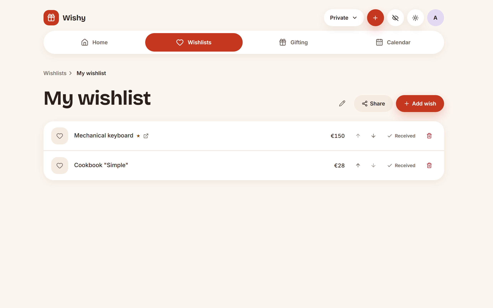

# Wishy

Wishy is a self-hosted app for planning wishes, gift ideas, (shared) gifts and budgets. The app UI is available in
English and German.

## Features

- **Wish lists** – as many as you like, each shareable by link (even without an account) or with app users. Anyone with
  access can reserve items; you never see what was reserved.
- **Spaces** – shared gift planning with an invite link: ideas, people (with birthdays), occasions (for everyone or selected people, individuals can be left out), gift status, cost shares, budgets.
- **Link import** – title, image and price from product pages (plain fetch, headless Chromium when needed).
- **Accounts** – email/password, 2FA (TOTP), passkeys, Google sign-in; registration open, invite-only or closed.
- **Admin** – users, audit log, API keys/REST API, optional AI features, backups, updates.
- **Operations** – signed updates (app or whole image), automatic rollback, encrypted backups.

## Screenshots

<!-- TODO (owner): put screenshots in docs/screenshots/ and embed them here, e.g.  -->

_Coming soon._

## Quick start (Docker Compose)

```bash
mkdir wishy && cd wishy
curl -fsSLO https://raw.githubusercontent.com/veniplex/wishy/main/docker-compose.yml
mkdir -p data && sudo chown 1000:1000 data     # the container runs as user "node" (UID 1000)
docker compose up -d
```

Then open <http://localhost:3000> and create the administrator account (`/setup`). Your data lives in the `./data` folder.

The bundled `docker-compose.yml` uses `ghcr.io/veniplex/wishy:latest`. To pin a specific version:

```bash
WISHY_IMAGE=ghcr.io/veniplex/wishy:1.0.0 docker compose up -d
```

(or change `image:` in the Compose file). Note: with `:latest`, a later `docker compose up -d` stays up to date after an
in-app image update; with a fixed tag you have to bump the tag yourself.

**Reverse proxy / HTTPS:** On the internet, only run Wishy behind HTTPS (session cookies, Google sign-in). Set `BASE_URL`
and `TRUST_PROXY` (number of proxy hops in front of the container) – details in [docs/operations.md](docs/operations.md#2-docker).

**Updates and backups:** Admin › Updates shows new versions (signed, default source `veniplex/wishy`); manually:
`docker compose pull && docker compose up -d`. Backups, restore and rollback: [docs/operations.md](docs/operations.md).

## Google sign-in (optional)

In the Google Cloud Console, create an OAuth client ID (type "Web application"), add `<BASE_URL>/api/auth/google/callback`
as the redirect URI, and set the client ID/secret in Admin › Sign-in (or via `GOOGLE_CLIENT_ID`/`GOOGLE_CLIENT_SECRET`).

## Configuration

| Variable | Default | Meaning |
| --- | --- | --- |
| `PORT` | `3000` | Server port (in the image: public port of the launcher) |
| `HOST` | `127.0.0.1` | Bind address (`0.0.0.0` in the image) |
| `DATA_DIR` | `./data` (image: `/data`) | Folder for database, images, keys, backups |
| `BASE_URL` | from the request | Public address (links, Google redirect), e.g. `https://wishy.example.com` |
| `TRUST_PROXY` | – | Behind a reverse proxy: number of hops, `true` or subnets |
| `GOOGLE_CLIENT_ID` / `GOOGLE_CLIENT_SECRET` | – | Google sign-in (locks the fields in the admin area) |
| `CHROME_PATH` | automatic | Chrome/Chromium for the link import fallback |
| `PREVIEW_BROWSER` | – | `off` disables the browser fallback |
| `PREVIEW_BROWSER_NO_SANDBOX` | – | `1` starts Chromium without its sandbox (container only, set in the image) |
| `TZ` | – | Time zone, relevant for the backup schedule |
| `BACKUP_PASSPHRASE` | – | overrides the passphrase set in Admin › Backups |
| `UPDATE_REPO` / `UPDATE_TOKEN` | `veniplex/wishy` / – | Update source (e.g. for forks) / token against the GitHub rate limit |
| `UPDATE_PUBLIC_KEY` | built in | replaces the public update key |
| `DOCKER_HOST` | – | Docker API for image updates (see security notes) |
| `WISHY_IMAGE_UPDATES` | – | `off` disables image updates |

More variables (update hosts, time limits) are listed in [docs/operations.md](docs/operations.md#2-docker).

## Security notes

- **Back up `secret.key` (in `DATA_DIR`).** It seals 2FA secrets, passphrases and tokens. Unencrypted backups
  deliberately do not contain it; encrypted backups cannot be restored without the passphrase.
- **Docker access for image updates is powerful** (roughly root on the host). Without it, Wishy only updates the app and
  npm packages. If you grant it, use the restricted socket proxy from `docker-compose.yml` (option B), not the directly
  mounted socket. See [docs/operations.md](docs/operations.md#32-image-updates-whole-container).
- Only run behind HTTPS; please report vulnerabilities privately: [SECURITY.md](SECURITY.md).

## Development

Requires Node.js 24 (built-in SQLite, no native dependencies).

```bash
npm ci
npm run dev          # API on :3000, frontend with hot reload on http://localhost:5173
npm run typecheck
npm run build        # type check + frontend build into dist/
npm start            # production mode on http://localhost:3000
npm run test:smoke   # HTTP smoke tests (own servers, temporary data folders)
npm run test:e2e     # backup/update end-to-end (long-running, needs dist/)
```

Test descriptions: [scripts/tests/README.md](scripts/tests/README.md). Release process for maintainers:
[docs/RELEASING.md](docs/RELEASING.md). Changes: [CHANGELOG.md](CHANGELOG.md).

Layout: `server/` (Express API + SQLite), `src/` (React/Vite/Tailwind, `i18n/` translations), `launcher/` (process
supervision, updates), `scripts/` (release, tests).

## License

No license has been chosen yet, so all rights are reserved for now.
