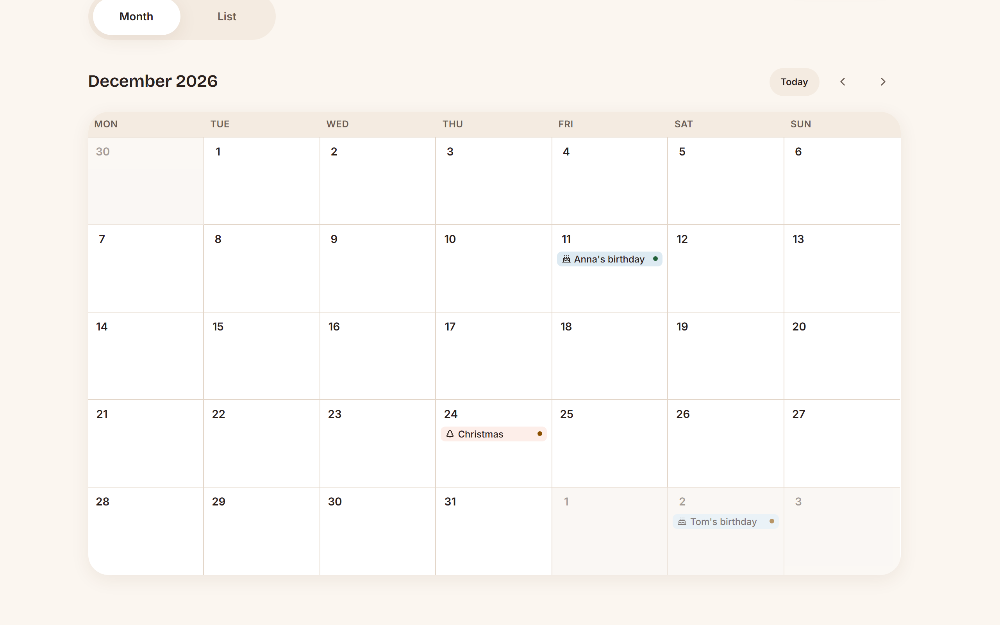

<div align="center">


# Wishy

**Wish lists, gift ideas and shared gift planning – self-hosted.**

[](https://github.com/veniplex/wishy/actions/workflows/ci.yml)
[](https://github.com/veniplex/wishy/releases)
[](https://github.com/veniplex/wishy/pkgs/container/wishy)

[Quick start](#quick-start) · [Features](#features) · [Configuration](#configuration) · [Operations guide](docs/operations.md) · [Changelog](CHANGELOG.md)

<picture>
  <source media="(prefers-color-scheme: dark)" srcset="docs/screenshots/dashboard-dark.png">
  
</picture>

</div>

Plan gifts around the people you give them to: collect ideas, keep track of birthdays and occasions, share the cost and
stay within budget. Share your own wish lists with anyone, and never see what has been reserved for you. Everything runs
in one container with one SQLite file. The interface is available in English and German.

## Features

- 🎁 **Wish lists:** as many as you like, shared by link (no account needed) or with other users. Guests reserve items and
  the owner never finds out which.
- 🧑‍🤝‍🧑 **Person-centred planning:** each person has a birthday, ideas and gifts, grouped by occasion. Occasions apply to
  everyone or to selected people, and you can leave individuals out.
- 📅 **Calendar:** month grid and list, recurring occasions and birthdays, your own occasion types.
- 🏠 **Spaces:** plan together with invite links and permissions per member.
- 💶 **Budgets and cost sharing:** gift status, payments, who owes what, spending overview.
- 🔗 **Link import:** title, image and price from product pages, with headless Chromium when needed.
- 📱 **Works offline:** install it as an app (PWA, needs HTTPS). Your data is available without a connection; changes are
  kept on the device and synchronised as soon as the server is reachable again.
- 🔐 **Accounts:** email and password, 2FA (TOTP), passkeys, Google sign-in; open, invite-only or closed registration.
- 🛠️ **Administration:** users, audit log, REST API with API keys, optional AI features (Anthropic, OpenAI, Google).
- 🔄 **Operations:** encrypted backups, signed updates of the app or the whole image, automatic rollback.

## Screenshots

| Planning for a person | Planning an occasion |
| --- | --- |
|  |  |
| **Calendar** | **Wish list** |
|  |  |

<div align="center"></div>

## Quick start

You need Docker with the Compose plugin.

**1.** Create a folder with a `data` directory. The container runs as UID 1000:

```bash
mkdir wishy && cd wishy
mkdir -p data && sudo chown 1000:1000 data
```

**2.** Save this as `docker-compose.yml`:

```yaml
services:
  wishy:
    image: ghcr.io/veniplex/wishy:latest
    container_name: wishy
    ports:
      - "3000:3000"
    volumes:
      - ./data:/data
    environment:
      TZ: Europe/Berlin
      # Behind a reverse proxy with HTTPS:
      # BASE_URL: https://wishy.example.com
      # TRUST_PROXY: "1"               # number of proxies in front of the container
    restart: unless-stopped
    stop_grace_period: 30s
    cap_drop: [ALL]
    security_opt: [no-new-privileges:true]
```

**3.** Start it and open <http://localhost:3000> to create the administrator account:

```bash
docker compose up -d
```

Your data lives in `./data`; back it up, including `secret.key`.

<details>
<summary><b>Pin a version</b></summary>

Replace `latest` with a version, for example `ghcr.io/veniplex/wishy:1.0.0`. With a fixed tag you have to raise the tag
yourself after an in-app image update; with `latest`, `docker compose up -d` stays up to date.

</details>

<details>
<summary><b>Update</b></summary>

*Admin › Updates* shows and installs new versions (signed, with a backup and rollback). Or manually:

```bash
docker compose pull && docker compose up -d
```

To update the whole image from within the app, Wishy needs access to the Docker API. The repository's
[docker-compose.yml](docker-compose.yml) contains a prepared, restricted socket proxy for this; please read
[the notes](docs/operations.md#32-image-updates-whole-container) first.

</details>

<details>
<summary><b>Reverse proxy and HTTPS</b></summary>

On the internet, only run Wishy behind HTTPS (session cookies, passkeys, Google sign-in). Set `BASE_URL` and
`TRUST_PROXY` (number of proxy hops in front of the container). Details: [docs/operations.md](docs/operations.md#2-docker).

</details>

<details>
<summary><b>Google sign-in (optional)</b></summary>

In the Google Cloud Console, create an OAuth client ID (type "Web application"), add `<BASE_URL>/api/auth/google/callback`
as the redirect URI, and set the client ID and secret in *Admin › Sign-in* (or via
`GOOGLE_CLIENT_ID` / `GOOGLE_CLIENT_SECRET`).

</details>

## Configuration

| Variable | Default | Meaning |
| --- | --- | --- |
| `PORT` | `3000` | Server port (in the image: public port of the launcher) |
| `HOST` | `127.0.0.1` | Bind address (`0.0.0.0` in the image) |
| `DATA_DIR` | `./data` (image: `/data`) | Folder for database, images, keys, backups |
| `BASE_URL` | from the request | Public address (links, Google redirect), e.g. `https://wishy.example.com` |
| `TRUST_PROXY` | – | Behind a reverse proxy: number of hops, `true` or subnets |
| `GOOGLE_CLIENT_ID` / `GOOGLE_CLIENT_SECRET` | – | Google sign-in (locks the fields in the admin area) |
| `CHROME_PATH` | automatic | Chrome/Chromium for the link import fallback |
| `PREVIEW_BROWSER` | – | `off` disables the browser fallback |
| `PREVIEW_BROWSER_NO_SANDBOX` | – | `1` starts Chromium without its sandbox (container only, set in the image) |
| `TZ` | – | Time zone, relevant for the backup schedule |
| `BACKUP_PASSPHRASE` | – | overrides the passphrase set in Admin › Backups |
| `UPDATE_REPO` / `UPDATE_TOKEN` | `veniplex/wishy` / – | Update source (e.g. for forks) / token against the GitHub rate limit |
| `UPDATE_PUBLIC_KEY` | built in | replaces the public update key |
| `DOCKER_HOST` | – | Docker API for image updates (see security notes) |
| `WISHY_IMAGE_UPDATES` | – | `off` disables image updates |

More variables (update hosts, time limits) are listed in [docs/operations.md](docs/operations.md#2-docker).

## Security notes

- **Back up `secret.key` (in `DATA_DIR`).** It seals 2FA secrets, passphrases and tokens. Unencrypted backups
  deliberately do not contain it; encrypted backups cannot be restored without the passphrase.
- **Docker access for image updates is powerful** (roughly root on the host). Without it, Wishy only updates the app and
  npm packages. If you grant it, use the restricted socket proxy from `docker-compose.yml` (option B), not the directly
  mounted socket. See [docs/operations.md](docs/operations.md#32-image-updates-whole-container).
- Only run behind HTTPS; please report vulnerabilities privately: [SECURITY.md](SECURITY.md).

## Development

Requires Node.js 24 (built-in SQLite, no native dependencies).

```bash
npm ci
npm run dev          # API on :3000, frontend with hot reload on http://localhost:5173
npm run typecheck
npm run build        # type check + frontend build into dist/
npm start            # production mode on http://localhost:3000
npm run test:smoke   # HTTP smoke tests (own servers, temporary data folders)
npm run test:e2e     # backup/update end-to-end (long-running, needs dist/)
```

Test descriptions: [scripts/tests/README.md](scripts/tests/README.md). Release process for maintainers:
[docs/RELEASING.md](docs/RELEASING.md). Changes: [CHANGELOG.md](CHANGELOG.md).

Layout: `server/` (Express API + SQLite), `src/` (React/Vite/Tailwind, `i18n/` translations), `launcher/` (process
supervision, updates), `scripts/` (release, tests).

## License

No license has been chosen yet, so all rights are reserved for now.
